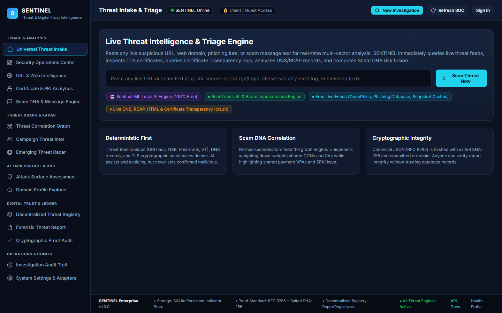

# SENTINEL

An AI-powered web threat detection, campaign correlation, and tamper-evident digital trust intelligence platform.

---

## Problem

Phishing URLs, fraudulent payment lures, lookalike domains, and malicious infrastructure rarely operate in isolation, yet defenders often rely on disconnected point tools: one utility for URL reputation, another for TLS checks, another for message analysis, and none that connect shared infrastructure across incidents. At the same time, many modern detection tools depend on paid third-party LLM or threat APIs, mix heuristic guesses with deterministic evidence, or store findings in mutable databases without verifiable audit proofs.

---

## Solution

**SENTINEL** unifies six threat intelligence and security posture engines behind a single FastAPI **Investigation Orchestrator**, backed by transactional SQLite persistence and a browser-based Security Operations Center (SOC) dashboard:

1. **URL & Domain Intelligence**: RFC 8785 canonicalization, boundary-aware brand impersonation detection, homoglyph/typosquatting analysis, punycode & mixed-script checks, SSRF protection with pinned IP resolution, redirect tracing, DNS/RDAP lookups, and multi-feed reputation adapters with offline fallbacks.
2. **TLS Certificate & PKI Analytics**: Dual-mode handshake inspection, certificate expiry/hostname/self-signed checks, SHA-256 and SPKI key pinning hashes, and `crt.sh` Certificate Transparency SAN/sibling discovery.
3. **On-Device Multilingual Scam DNA (`Sentinel-ML`)**: Zero-paid-API NLP and lexical classification across English, Hindi, Bengali, and Malayalam, deterministic extraction of phone numbers, UPI IDs, emails, URLs, and IFSC codes, MinHash template fingerprinting, and prompt-injection containment.
4. **Threat Correlation & Emerging Scam Radar**: Inverted-index graph construction over normalized indicators with IDF uniqueness weighting ($u = 1 / \log_2(2 + df)$), CDN/CA noise caps, campaign clustering without weak-link chaining, and 3-sigma surge detection (`100.0%` precision, `76.9%` recall, `0` false positives on benchmark).
5. **Attack Surface & DNS Monitoring**: Passive website grading (`A`–`F`) over HTTP security headers (`HSTS`, `CSP`, `X-Frame-Options`, `X-Content-Type-Options`, `Referrer-Policy`), TLS versions, DNS records (`SPF`, `DMARC`, `CAA`, `DNSSEC`), and domain monitoring subscriptions.
6. **Tamper-Evident Forensic Reporting**: RFC 8785 canonical JSON serialization, salted SHA-256 versioned commitments stored in SQLite, independent JSON proof-bundle export, `LocalLedger` verification, and an optional EVM smart contract (`contracts/ReportRegistry.sol`).

---

## Demo Links & Screenshot

- **Live Web Application:** https://sentinel-threat-intelligence-production.up.railway.app
- **Interactive API Docs (Swagger UI):** https://sentinel-threat-intelligence-production.up.railway.app/docs
- **Live Health Endpoint:** https://sentinel-threat-intelligence-production.up.railway.app/health



---

## Tech Stack

- **Backend & API:** Python 3.11, FastAPI, Uvicorn, Pydantic v2
- **Database:** SQLite (WAL mode, explicit `BEGIN`/`COMMIT`/`ROLLBACK` transactions, `threading.RLock` synchronization)
- **Authentication & Cryptography:** Custom HMAC-SHA256 JWT tokens, PBKDF2-HMAC-SHA256 (`100,000` iterations) password hashing, RFC 8785 canonical JSON + salted SHA-256 commitments (`cryptography`)
- **Networking & Intelligence:** `httpx`, `dnspython`, `urllib`, `ssl`, on-device `Sentinel-ML` engine
- **Frontend:** Single-page SOC Dashboard (HTML5, CSS3, Vanilla JavaScript, Canvas graph visualization)
- **Blockchain / Smart Contracts (Optional):** Solidity, Hardhat, TypeScript (`contracts/ReportRegistry.sol`)
- **Deployment & Infrastructure:** Multi-stage Docker (`python:3.11-slim`), Nginx reverse proxy, Railway (persistent volume at `/app/data`), Render (`render.yaml`)
- **Testing:** `pytest`

---

## Architecture

```text
  URL / Domain / Message / Site Audit Submission
                       │
                       ▼
           FastAPI REST API & Auth/RBAC
      (JWT Bearer, Rate Limiter, Security Headers)
                       │
                       ▼
           Investigation Orchestrator
   ┌──────────────┬──────────────┬──────────────┐
   ▼              ▼              ▼              ▼
URL, Feeds &   TLS & crt.sh   Sentinel-ML    Passive Site &
 DNS/RDAP       Inspector     (Scam DNA)     DNS Posture Scan
   └──────────────┴──────────────┴──────────────┘
                       │
                       ▼
      Transactional SQLite Store (indicators,
        investigations, reports, monitoring)
                       │
          ┌────────────┴────────────┐
          ▼                         ▼
   Correlation Engine         Forensic Reports
  (Inverted Index Graph,     (RFC 8785 JSON + Salt +
   Campaigns & 3σ Radar)      LocalLedger / EVM Registry)
```

### Repository Structure

```text
.
├── backend/
│   ├── app/
│   │   ├── core/          # SSRF IP-pinning guards, URL/phone normalizers, safe HTTP
│   │   ├── db/            # Thread-safe transactional SQLite storage
│   │   ├── services/      # Feeds, TLS, crt.sh, DNS/RDAP, Sentinel-ML, correlation, reports
│   │   ├── auth.py        # JWT + PBKDF2 authentication & RBAC
│   │   ├── main.py        # FastAPI application and REST routes
│   │   └── orchestrator.py
│   ├── data/              # Offline intelligence caches & SQLite DB path
│   ├── static/            # Unified SOC web dashboard
│   ├── tests/             # Unit, API, benchmark, AI, and production safety tests
│   └── requirements.txt
├── contracts/             # ReportRegistry.sol EVM registry contract
├── docs/                  # Dashboard screenshot
├── nginx/                 # Reverse proxy & rate-limit config
├── scripts/               # Deployment & healthcheck utilities
├── Dockerfile
├── docker-compose.yml
└── render.yaml
```

---

## Setup and Run Steps

### 1. Clone and Configure Environment

```bash
git clone https://github.com/PritamMondal1169/sentinel-threat-intelligence.git
cd sentinel-threat-intelligence
cp .env.example .env
```

Update `SENTINEL_JWT_SECRET`, `SENTINEL_ADMIN_PASSWORD`, and `SENTINEL_ANALYST_PASSWORD` in `.env` before public deployment. No paid API keys are required—SENTINEL runs out of the box using on-device `Sentinel-ML` and free public intelligence feeds/caches.

### 2. Install Dependencies & Start Backend

```bash
cd backend
pip install -r requirements.txt
uvicorn app.main:app --host 127.0.0.1 --port 8000 --workers 1
```

Open `http://127.0.0.1:8000` in your browser (API documentation at `http://127.0.0.1:8000/docs`).

### 3. Run Tests, Benchmark & Health Probe

```bash
# Run full test suite (103 passed, 15 subtests passed)
pytest backend/tests -v

# Run correlation benchmark (from backend/)
python -m app.evaluation

# Probe running server health
python scripts/healthcheck.py http://127.0.0.1:8000/health
```

### 4. Container Deployment (Docker Compose)

```bash
docker compose up --build -d
```

Access via `http://localhost` (place TLS termination in front of Nginx for internet-facing deployments).

---

## Disclosures

- **Open-Source Libraries:** `fastapi`, `uvicorn[standard]`, `pydantic`, `cryptography`, `httpx`, `dnspython`, `pytest`, and optional Solidity contract tooling (`hardhat`, `@nomicfoundation/hardhat-toolbox`, `typescript`, `ts-node`).
- **Public APIs & Feeds Used:** `crt.sh` (Certificate Transparency logs), `rdap.org` (domain registration RDAP lookup), `OpenPhish` (`openphish.com/feed.txt`), `Phishing.Database` active domain list, `abuse.ch URLhaus` (`urlhaus-api.abuse.ch`), `PhishTank`, and standard DNS queries (`A`/`AAAA`/`MX`/`NS`/`TXT`/`CNAME`/`CAA`). Optional BYO-key adapters exist for Google Safe Browsing v4, VirusTotal v3, and Google Gemini (`GEMINI_API_KEY`) when explicitly configured.
- **Templates / Scaffolding:** Built from scratch for the SENTINEL architecture using standard FastAPI, Docker, Nginx, and Hardhat project configurations.
- **AI Coding Assistants:** Developed and hardened with assistance from Google Antigravity AI coding tools for test generation, security hardening, documentation, and deployment troubleshooting.

---

## Track

**Cybersecurity / AI & Digital Trust** *(Open Innovation — Threat Intelligence & Phishing Defense)*
